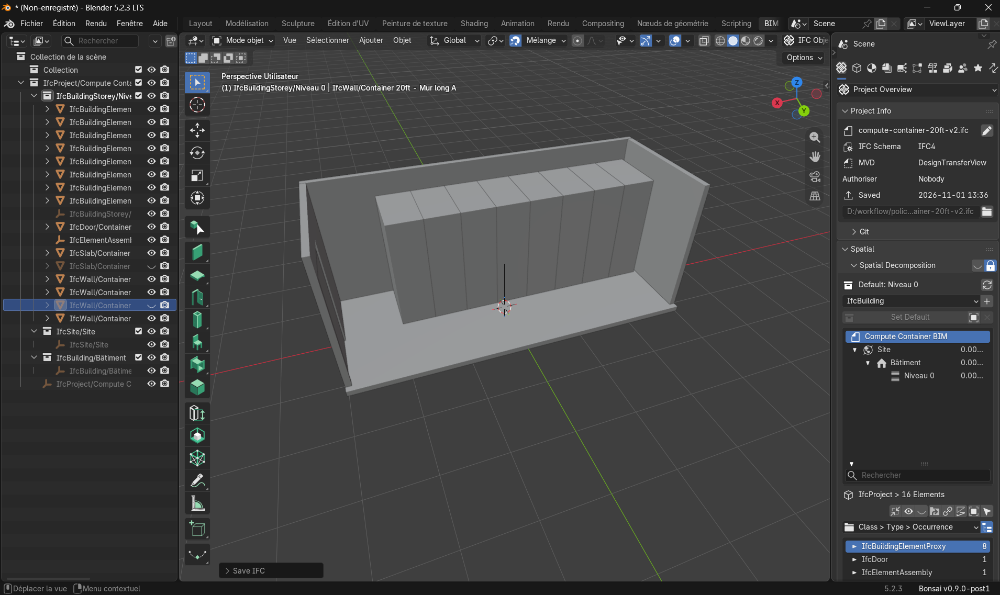
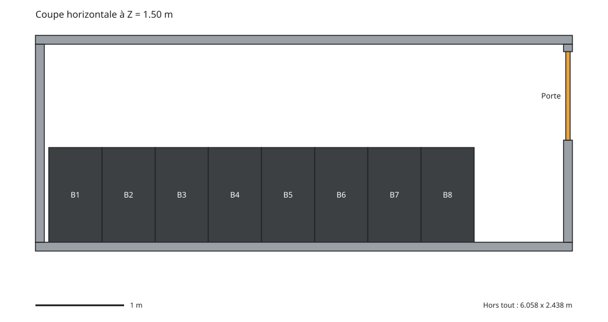

# compute-container-bim

Maquette BIM d'un conteneur de calcul (20 ft), générée et enrichie par scripts Python.

> Projet personnel d'apprentissage, indépendant. Non affilié à Policloud ni à Antimatter.
> Les données d'exemple proviennent des spécifications publiques du modèle Policloud 100
> (policloud.com, consulté le 27/10/2026).



## Pourquoi ce projet

**BIM (Building Information Modeling)** : maquette numérique 3D dont chaque objet porte des
données exploitables. Ici, un conteneur de calcul n'est pas qu'une forme : il connaît sa
puissance, son nombre de GPU, son stockage et son emprise au sol.

L'objectif est de relier la géométrie d'une unité de calcul modulaire à ses caractéristiques
de puissance de calcul, puis d'automatiser par script ce qui se fait d'habitude à la main.

## Ce que le projet contient aujourd'hui

**Version 1 : volume simple, fait à la main**
- Un modèle IFC4 d'un conteneur 20 ft (6,058 x 2,438 x 2,591 m), créé avec Blender et Bonsai.
  C'est un bloc plein, sans détail interne.
- `scripts/ajouter_proprietes.py` : ajoute un jeu de propriétés `Policloud` au conteneur
  (puissance max, GPU, vCPU, stockage, plage de température, emprise au sol, refroidissement)
  et enregistre le résultat dans un nouveau fichier, sans toucher à l'original.

**Version 2 : coque creuse, entièrement générée par code**
- `scripts/creer_conteneur.py` : crée de zéro un fichier IFC4 avec la hiérarchie
  projet / site / bâtiment / niveau, puis un conteneur composé de 6 pièces (sol, toit,
  2 longs murs, 2 murs de bout, parois de 10 cm), regroupées sous un `IfcElementAssembly`.
  Les propriétés de calcul sont portées par l'assemblage.
- Une porte de service (1,0 x 2,0 m) dans un mur de bout : le mur est percé
  (`IfcOpeningElement` + `IfcRelVoidsElement`) puis rempli par la porte (`IfcRelFillsElement`).
- 8 baies informatiques illustratives (0,6 x 1,07 x 2,0 m, format 42U) alignées contre un long mur.
- La fonction `creer_conteneur(...)` prend une position (x, y, z) : elle pourra être appelée
  plusieurs fois pour placer plusieurs unités.

**Plan en coupe**
- `scripts/generer_plan.py` : coupe le modèle IFC à une hauteur donnée (1,50 m par défaut) et
  dessine le plan vu de dessus en SVG : murs, baies B1 à B8, porte, échelle graphique et
  dimensions hors tout. Il ne lit que les éléments extrudés depuis un rectangle, ce qui est le
  cas de tout ce que produit `creer_conteneur.py`.



**Outil de contrôle**
- `scripts/lire_ifc.py` : lit un fichier IFC et affiche pour chaque élément son nom, sa classe
  IFC, sa position et ses dimensions.

## Structure

```
compute-container-bim/
├── scripts/
│   ├── lire_ifc.py
│   ├── ajouter_proprietes.py
│   ├── creer_conteneur.py
│   └── generer_plan.py
├── models/
│   ├── policloud-container-20ft.ifc          v1 : bloc, fait à la main
│   ├── policloud-container-20ft-enrichi.ifc  v1 avec propriétés
│   └── compute-container-20ft-v2.ifc         v2 : coque creuse, générée par script
├── docs/
│   ├── coupe-blender.png
│   └── plan-coupe.svg
├── LICENSE
├── requirements.txt
└── README.md
```

## Installation

Prérequis : Python 3.12 (testé avec 3.12.10).

```bash
python -m venv .venv
source .venv/Scripts/activate    # Git Bash sous Windows
pip install -r requirements.txt
```

## Utilisation

```bash
# Générer la coque creuse (écrase models/compute-container-20ft-v2.ifc)
python scripts/creer_conteneur.py

# Contrôler le résultat
python scripts/lire_ifc.py models/compute-container-20ft-v2.ifc

# Générer le plan en coupe (SVG)
python scripts/generer_plan.py
python scripts/generer_plan.py --hauteur 1.2 --sortie docs/plan-1m20.svg

# Ajouter les propriétés de calcul à la version 1
python scripts/ajouter_proprietes.py
```

Les fichiers `.ifc` s'ouvrent dans Blender avec l'extension Bonsai (*Open IFC Project*).
Pour modifier le modèle, relancer le script plutôt qu'enregistrer depuis Blender : Bonsai
réécrit le fichier IFC.

## Propriétés ajoutées (jeu `Policloud`)

| Propriété | Valeur |
|---|---|
| Modele | Policloud 100 |
| ConteneurPieds | 20 |
| PuissanceMaxKW | 100.0 |
| NombreGPU | 104 |
| vCPUMin | 6000 |
| StockagePB | 2.0 |
| TemperatureMinC / MaxC | -40.0 / 45.0 |
| EmpriseSolM2 | 50.0 (dégagements inclus) |
| RefroidissementEau | False |

## Limites connues

- La coque est une représentation simplifiée : parois de 10 cm, une seule porte, pas de
  ventilation ni de climatisation.
- L'agencement interne (baies, porte) est **illustratif** : cotes de racks standard 42U, non
  issues du fabricant, dont l'agencement n'est pas public.
- `generer_plan.py` ne lit pas les maillages faits à la main (version 1).
- Les scripts ont été testés uniquement sur ces modèles.
- Les valeurs sont celles annoncées par le fabricant, non vérifiées de façon indépendante.

## Pistes suivantes

- Implantation de N unités sur un terrain (50 m² par unité) avec calcul automatique de la
  puissance totale, du nombre de GPU et de l'emprise du site.
- Contrôles automatiques (propriétés obligatoires, cohérence des dimensions).

## Outils

Blender 5.2 LTS, Bonsai 0.9 (extension BIM), IfcOpenShell 0.9, Python 3.12.

## Licence

MIT, voir le fichier `LICENSE`.
